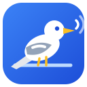
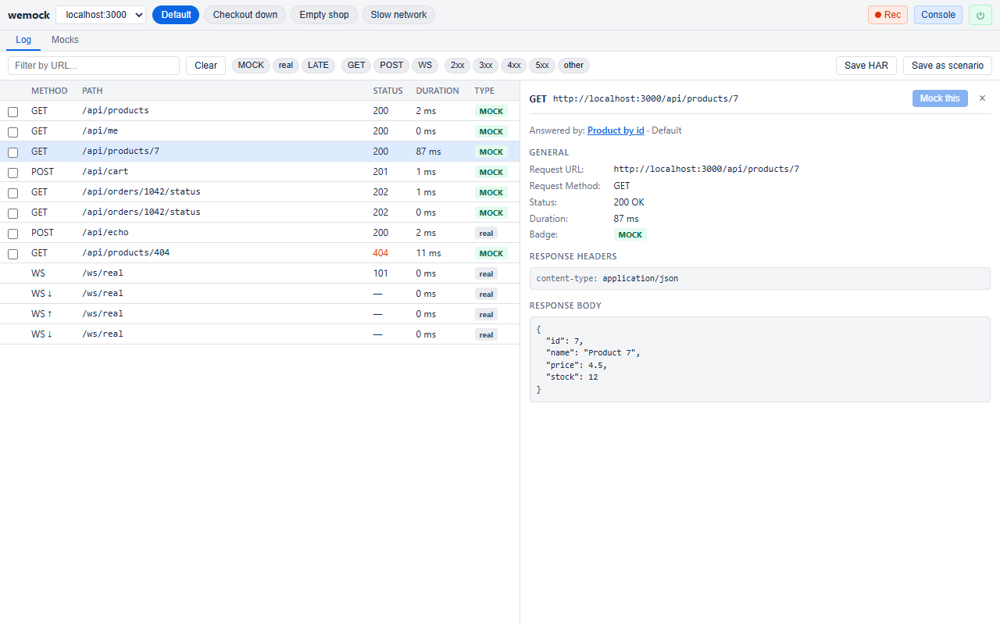
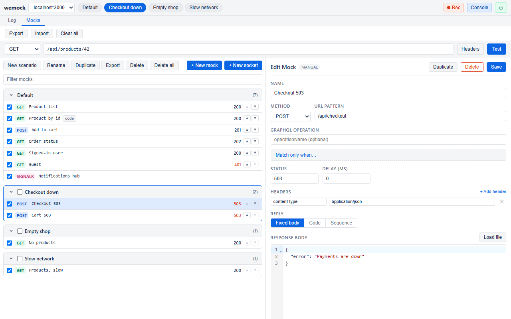
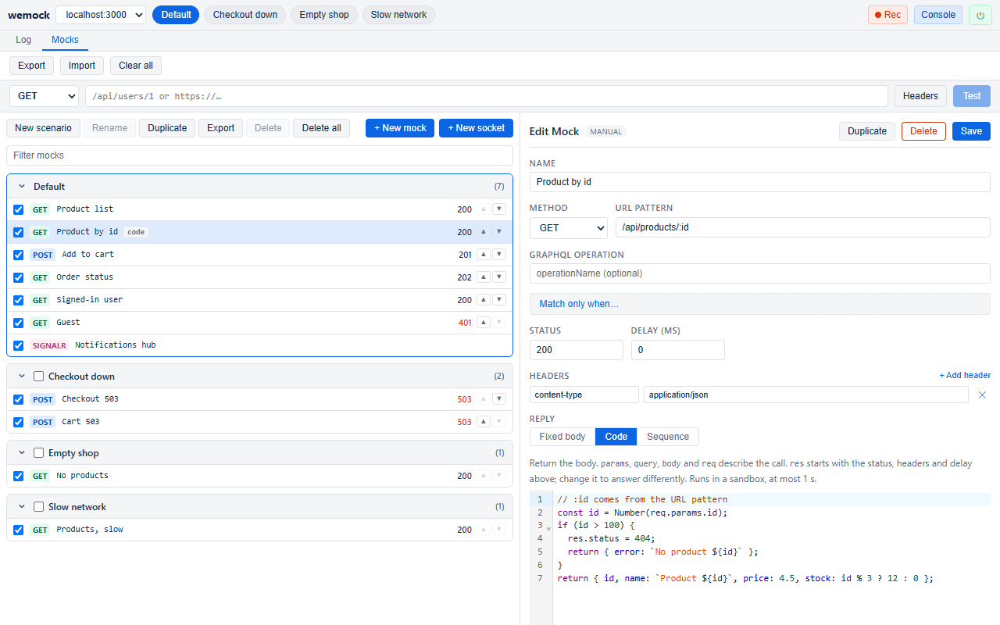
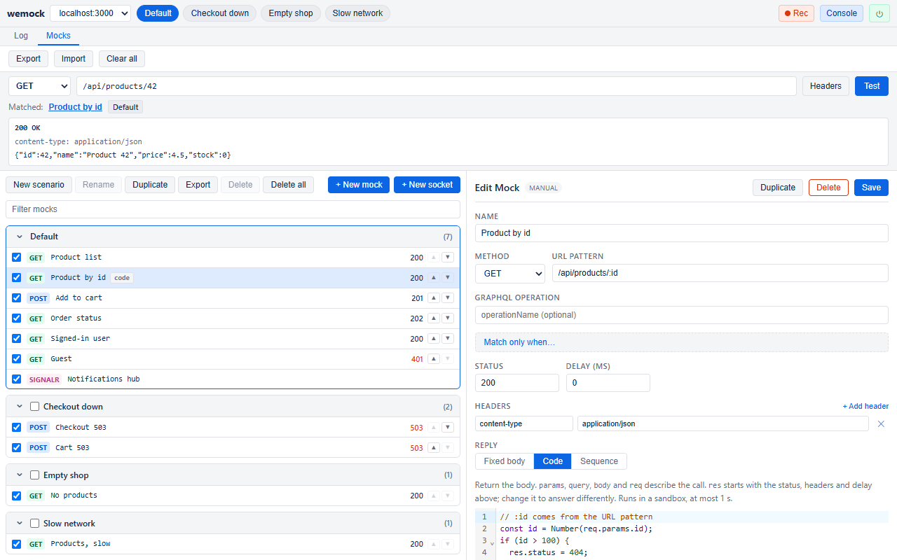
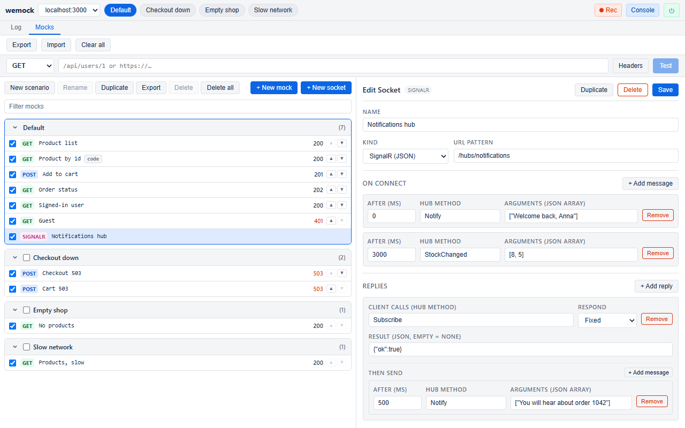

<p align="center">
  
</p>

<h1 align="center">wemock</h1>

<p align="center"><em>It hears your API once. Then it answers for it.</em></p>

<p align="center">
  <a href="https://github.com/Ank-KhoaHo/wemock/releases/latest"></a>
  <a href="https://github.com/Ank-KhoaHo/wemock/actions/workflows/ci.yml"></a>
  
  <a href="LICENSE"></a>
</p>

<p align="center">
  <a href="#install">Install</a> ·
  <a href="guide/README.md">Guide</a> ·
  <a href="https://github.com/Ank-KhoaHo/wemock/releases">Releases</a> ·
  <a href="ROADMAP.md">Roadmap</a>
</p>

---

A Chrome DevTools panel for front-end developers. It logs your page's API calls, turns any call
into a mock with one click, and serves that mock back to the page. Group mocks into scenarios,
"empty list", "server down", "slow network", and switch between them in one click.

A mockingbird copies the calls of other birds. wemock copies your API's.

## Mock a call in three clicks

Click a call in the Log. Click **Mock this**. Reload. The page now gets wemock's answer, and the
Log marks it `MOCK` and names the mock that answered.



Mock a whole filtered list at once with **Save as scenario**. A call to another site keeps its
host, so the mock answers only that site. → [Your first mock](guide/first-mock.md)

## Every state your backend rarely gives you

The Default scenario always applies. Switch on "Checkout down" and checkout answers 503, while
everything else keeps working. Switch back with one click.



→ [Scenarios](guide/scenarios.md)

## When a fixed body is not enough, answer with code

A few lines of JavaScript read the call's URL parameters, query, body and headers, and set the
status. `/api/products/:id` answers each product by its id, and 404 past the end of the shop.
The code runs in a sandbox, for at most one second.



Templates (`{{params.id}}`), sequences ("pending, pending, done") and **Change real** (let the
real call through, then change one field) cover the cases in between. → [Replies](guide/replies.md)

## Know which mock answers, before you reload

Type a URL in the Test bar. wemock shows which mock answers, from which scenario, and exactly
what it returns. Code mocks really run.



Each mocked call also writes one line to the page's Console. → [Checking your mocks](guide/checking.md)

## WebSocket and SignalR, with no server

A socket mock sends messages on a timeline and answers what the client sends. For SignalR hubs
wemock also speaks negotiate, the handshake and the pings, so `start()`, `on()`, `invoke()` and
`stream()` work as with a real hub, errors included. Or record a real socket, then **Mock this
socket**.



→ [WebSocket and SignalR](guide/sockets.md)

## Install

wemock is not on the Chrome Web Store yet. Until it is:

1. Download `wemock-<version>-chrome.zip` from the
   [latest release](https://github.com/Ank-KhoaHo/wemock/releases/latest), and unzip it.
2. Open `chrome://extensions` and turn on **Developer mode**.
3. Choose **Load unpacked**, and pick the unzipped folder.

Or build it from source:

```
npm ci
npm run build
```

Then load `.output/chrome-mv3` the same way. → [Install, in full](guide/install.md)

**Then:** open your app on `localhost` (wemock is always on there), open DevTools, and pick the
**wemock** tab. On any other site, click the wemock toolbar icon and switch it on for that site.

**No app handy?** In the empty Mocks tab, click **Load the sample** (next release): a small shop
with every kind of mock, three scenarios and a SignalR hub. Then try `GET /api/products/42` in the
Test bar.

## Everything it does

| You want to | wemock | Guide |
|---|---|---|
| Record, then replay | **Mock this** on one call, **Save as scenario** on a list | [First mock](guide/first-mock.md) |
| Start from a file | Import HAR, OpenAPI 3, Swagger 2 (JSON or YAML) or Mokku's files | [Import and export](guide/import-export.md) |
| Switch whole states | Scenarios over a Default, with Undo | [Scenarios](guide/scenarios.md) |
| Match exactly | `:id`, `*rest`, `{optional}`, a host, a GraphQL operation, conditions on query, headers or body | [Matching](guide/matching.md) |
| Answer anything | Any status 200-599, headers, delays, text or binary bodies | [Replies](guide/replies.md) |
| Answer per call | Templates, sequences, code, Change real | [Replies](guide/replies.md) |
| Stream an answer | Chunks over time, Server-Sent Events, `EventSource` (next release) | [Replies](guide/replies.md#stream-next-release) |
| Change real calls | Add, change or remove request headers (next release) | [Request headers](guide/headers.md) |
| Mock sockets | WebSocket timelines and replies, SignalR hubs | [Sockets](guide/sockets.md) |
| Check before you reload | Test bar, Console line, Log filters, Save as HAR | [Checking](guide/checking.md) |

Works with `fetch`, `XMLHttpRequest`, and libraries built on them (axios included). Every row,
button and field works from the keyboard. React, axios, Angular `HttpClient` and a real
ASP.NET Core SignalR hub are part of the tests.

## FAQ

**Does it send my data anywhere?**
No. Mocks live in your browser (`chrome.storage.local`). wemock makes no network calls of its own.

**Does it run on every site I visit?**
No. Only on `localhost`, `127.0.0.1`, and the sites you switch on, one at a time.

**Why does a mocked call not show in the Network tab?**
It never leaves the page, so the network never sees it. The wemock Log and the Console line do.

**Is code in a code mock safe?**
It runs in a sandboxed extension page with no access to your page or to wemock, and stops after
one second. wemock never downloads code.

**Does it replace Mokku?**
It imports Mokku's files, and adds scenarios, code, sockets and SignalR. Try both.

**Why a mockingbird?**
It hears a call once and sings it back. That is the whole product.

## Limits

- Calls made by Service Workers are not seen. Server-Sent Events can be mocked (next release), but
  real ones are not logged.
- A real socket logs at most 200 messages. "Mock this socket" replays a plain socket's
  messages on a timeline; it cannot tell which message answered which.
- SignalR mocks speak the JSON hub protocol only, not MessagePack.
- Mocked calls do not appear in DevTools' Network tab: they never leave the page. Use the
  wemock log or the Console line.
- Code replies run in a sandboxed extension page with no access to the page or to wemock,
  and stop after 1 second. Code that fails answers status 500 with its error message.
- A call made before wemock has loaded its mocks waits up to 200 ms, then goes through and is
  marked `LATE`.
- Only Chrome (and Chromium browsers) for now.

## Where things live

| File | What it holds |
|---|---|
| [guide/](guide/README.md) | how to use every feature, one page each |
| [CONTRIBUTING.md](CONTRIBUTING.md) | how to build and test it, and what gets rejected |
| [SECURITY.md](SECURITY.md) | how to report a vulnerability, and what is not one |
| [ROADMAP.md](ROADMAP.md) | direction, and the things deliberately not coming |
| [PUBLIC.md](PUBLIC.md) | why some material is deliberately not published here |
| [LICENSE](LICENSE) | what you may do with this |

## Status

Version 1.7.0, before its first Store release. `main` is ahead of the latest release; the guide
marks features that are not released yet. Licensed under MIT; see [LICENSE](LICENSE).
