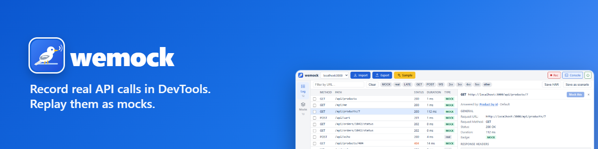

# wemock

*It hears your API once. Then it answers for it.*

## What it is

A free, open-source Chrome DevTools panel for front-end developers. It logs your page's API calls, turns any call
into a mock with one click, and serves that mock back to the page. Group mocks into scenarios,
"empty list", "server down", "slow network", and switch between them in one click.

A mockingbird copies the calls of other birds. wemock copies your API's.

## Get started

**Add wemock from the [Chrome Web Store](https://chromewebstore.google.com/detail/wemock/meoiipgffocfcgafaakjkodmfmmfoggk).** It is free.

Open your app on `localhost`, open DevTools, and pick the **wemock** tab. No app handy? In the empty Mocks
tab, click **Load the sample**. → [Install](https://ank-khoaho.github.io/wemock/install), from a release or from source too

## How to use it

| You want to | wemock | Guide |
|---|---|---|
| Record, then replay | **Mock this** on one call, **Save as scenario** on a list | [First mock](https://ank-khoaho.github.io/wemock/first-mock) |
| Start from a file | Import HAR, OpenAPI 3, Swagger 2 (JSON or YAML) or JSON mock files | [Import and export](https://ank-khoaho.github.io/wemock/import-export) |
| Switch whole states | Scenarios over a Default, with Undo | [Scenarios](https://ank-khoaho.github.io/wemock/scenarios) |
| Match exactly | `:id`, `*rest`, `{optional}`, a host, a GraphQL operation, conditions on query, headers or body | [Matching](https://ank-khoaho.github.io/wemock/matching) |
| Answer anything | Any status 200-599, headers, delays, text or binary bodies | [Replies](https://ank-khoaho.github.io/wemock/replies) |
| Answer per call | Templates, sequences, code, Change real | [Replies](https://ank-khoaho.github.io/wemock/replies) |
| Stream an answer | Chunks over time, Server-Sent Events, `EventSource` | [Replies](https://ank-khoaho.github.io/wemock/replies#stream) |
| Change real calls | Add, change or remove request headers | [Request headers](https://ank-khoaho.github.io/wemock/headers) |
| Mock sockets | WebSocket timelines and replies, SignalR hubs | [Sockets](https://ank-khoaho.github.io/wemock/sockets) |
| See which mock answered | Answered by in the Log, Console line, Log filters, Save as HAR | [Checking](https://ank-khoaho.github.io/wemock/checking) |

**The whole guide, with pictures and search: [ank-khoaho.github.io/wemock](https://ank-khoaho.github.io/wemock/).**

## Status

Version 1.10.0, on the [Chrome Web Store](https://chromewebstore.google.com/detail/wemock/meoiipgffocfcgafaakjkodmfmmfoggk) since 2026-11-16.

## Limits

- Calls made by Service Workers and Web Workers are not seen.
- Mocked calls do not appear in DevTools' Network tab: they never leave the page.
- Only Chrome (and Chromium browsers) for now.

→ [All limits](https://ank-khoaho.github.io/wemock/limits)

## Alternatives

wemock is a panel in your own browser. Something else is the better choice when:

- **The mocks must run in CI or for the whole team.** Put a mock layer in the app's code or
  test setup, so every run gets the same answers without an extension.
- **Another device must see them,** such as a phone or another browser. Use a mock server or
  a proxy that every client calls.
- **You only need to change one file the page loads.** Chrome's own Local Overrides, in the
  Sources panel, do that with nothing to install.

## FAQ

**Does it send my data anywhere?**
No. Mocks live in your browser (`chrome.storage.local`). wemock makes no network calls of its own.

**Does it run on every site I visit?**
No. Only on `localhost`, `127.0.0.1`, and the sites you switch on, one at a time.

→ [More questions](https://ank-khoaho.github.io/wemock/faq)

## Documentation

| File | What it holds |
|---|---|
| [Documentation site](https://ank-khoaho.github.io/wemock/) | how to use every feature, one page each, with search |
| [CONTRIBUTING.md](CONTRIBUTING.md) | how to build and test it, and what gets rejected |
| [SECURITY.md](SECURITY.md) | how to report a vulnerability, and what is not one |
| [ROADMAP.md](ROADMAP.md) | direction, and the things deliberately not coming |
| [PUBLIC.md](PUBLIC.md) | why some material is deliberately not published here |
| [LICENSE](LICENSE) | what you may do with this |

## Licence

Licensed under MIT; see [LICENSE](LICENSE).
